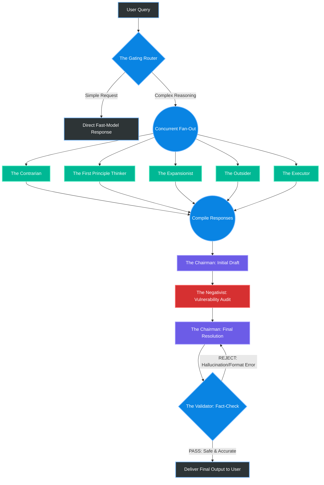

# Project Documentation: Multi-Agentic Reasoning System (MARS)

## 1. Project Overview & Theoretical Foundation

This project introduces a custom **Mixture-of-Agents (MoA) / LLM Council architecture** designed to systematically force Large Language Models (LLMs) to catch their own hallucinations, biases, and logical blind spots. 

Standard single-model inference—even with frontier models like GPT-4o or Claude 3.5—often falls victim to "echo chamber" effects, where the model confidently hallucinates facts or ignores obvious structural flaws in its own reasoning. By utilizing a 9-node, multi-provider pipeline, MARS triggers parallel deliberation, adversarial red-teaming, and strict algorithmic validation to simulate a highly critical human boardroom.

It is engineered to run entirely on permanent free-tier API developer endpoints by intelligently distributing the computational load, token context, and reasoning requirements across different hardware providers based on their specific strengths.

**Target Use Case:** Academic Minor Project. 
**Key Academic Deliverables:** 
*   **System Design:** Demonstrating mastery of Distributed Orchestration.
*   **Resilience Engineering:** Handling asynchronous API rate limits, failovers, and timeouts.
*   **Baseline Benchmarking:** Quantitatively proving that a 9-node orchestrated council of smaller/free models can outperform a single, expensive frontier model in accuracy and logic.

---

## 2. System Architecture & Flow Mechanics

The system operates in a rigorous, highly aggressive validation loop consisting of 9 distinct LLM calls across 4 sequential phases. Each phase is deliberately isolated to prevent early consensus or "groupthink."

### Phase 1: Intake & Triage (The Gateway)

Before burning tokens and compute on a massive council, the query must be evaluated.
1. **The Gating Router:** Evaluates prompt complexity. Simple queries (e.g., "What is the capital of France?" or "Write a python print statement") bypass the council entirely for a direct, low-latency response. Complex queries (strategy, architecture, abstract reasoning) trigger the full pipeline. *Implication: This saves up to 85% of API quota on trivial tasks.*

### Phase 2: Concurrent Fan-Out (The Council)

If the query is complex, 5 distinct personas are triggered **simultaneously**. Crucially, they do not see each other's work at this stage. This isolation forces diverse, uncontaminated perspectives.
2. **The Contrarian:** Actively seeks failure points.
3. **The First Principle Thinker:** Strips away assumptions to look at raw data.
4. **The Expansionist:** Looks for unstated opportunities and scale.
5. **The Outsider:** A cynic who demands proof for industry-standard assumptions.
6. **The Executor:** Grounds the conversation in immediate, practical realities.

*Example:* If a user asks, "How do I start a drone delivery business?", The Expansionist will suggest global logistics domination, while The Contrarian will immediately flag FAA regulations and battery physics as catastrophic failure points. 

### Phase 3: Synthesis & Adversarial Red-Teaming (The Executive Tier)

This is a sequential, dialectic phase where ideas are merged and subsequently attacked.
7. **The Chairman (Draft 1):** Takes the 5 highly conflicting council responses, synthesizes them, resolves contradictions, and creates a cohesive, initial strategic draft.
8. **The Negativist (The Red-Team):** Reads *only* the Chairman's draft (not the raw council inputs). Its sole job is to attack this draft, searching for logical fallacies, catastrophic risks, and security vulnerabilities. 
*(Loop)*: The Chairman receives the Negativist's highly critical audit and is forced to rewrite the final answer to patch all identified vulnerabilities.

### Phase 4: Final Validation (The Ground-Truth Auditor)

9. **The Validator:** A sterile, logic-only, zero-temperature node. It does not care about the strategy. It parses the final output to ensure no syntax errors in generated code, no broken markdown, and no explicitly hallucinated URLs slipped through. 

### 2.1 Architecture Flowchart



---

## 3. Infrastructure & API Map (Zero-Cost Optimization)

To bypass aggressive rate limits (like Gemini Free Tier's 15 RPM) and token ceilings, the 9 nodes are distributed across 7 different API providers. All configurations below utilize the standard OpenAI Python SDK format (just swapping base URLs and API keys). 

This multi-provider strategy also ensures that if one provider goes down (e.g., Groq experiences an outage), the system can implement a graceful fallback to another provider.

| Node | Persona | Provider | Suggested Model | Rationale & Compute Strategy | 
| ----- | ----- | ----- | ----- | ----- | 
| **1** | **Gating Router** | Cloudflare | `@cf/meta/llama-3-8b-instruct` | **Edge Compute:** Serverless edge execution for instant triage. Latency here must be < 500ms. | 
| **2** | **The Contrarian** | Groq | `llama-3.1-8b-instant` | **LPU Speed:** Groq's specialized hardware provides instant generation, perfect for a rapid, focused critique. | 
| **3** | **1st Principle Thinker** | Cerebras | `qwen3-32b` | **High Throughput:** 2,000+ tokens/sec & 1M daily tokens; ideal for heavy analytical lifting and deep reasoning. | 
| **4** | **The Expansionist** | OpenRouter | `meta-llama/llama-3.1-8b-instruct:free` | **Resource Pooling:** Keeps core API pools clear by utilizing open-source free clusters, acting as a load balancer. | 
| **5** | **The Outsider** | Mistral AI | `mistral-small-latest` | **Cognitive Diversity:** Distinct European architecture/training data provides a genuinely different semantic perspective. | 
| **6** | **The Executor** | Cerebras | `llama-3.3-70b` | **High Parameter Context:** A 70B model is required to provide highly accurate, step-by-step practical implementation details. | 
| **7** | **The Chairman** | Gemini (AI Studio)| `gemini-2.5-flash` or `3.5-flash` | **Massive Context:** Requires a 1M+ token context window to ingest 5 parallel outputs seamlessly without losing instruction fidelity. | 
| **8** | **The Negativist** | GitHub Models | `claude-3.5-sonnet` or `gpt-4o` | **Frontier Intelligence:** Requires world-class reasoning for red-teaming. We reserve GitHub's low-RPM free tier exclusively for this node. | 
| **9** | **The Validator** | Groq | `llama-3.3-70b-versatile` | **Structural Precision:** Flawless JSON and tool-use parsing to generate absolute boolean (Pass/Fail) metrics. | 

---

## 4. Persona Traits, Rationales, & System Prompts

*Critical Note: These system prompts must be hardcoded into the system message of the API calls. You must use high-temperature settings (e.g., 0.7 - 0.9) for the Council to encourage divergence, but low-temperature settings (0.0 - 0.1) for the Validator and Router to ensure deterministic behavior.*

### The Council (Parallel Nodes)

**1. The Contrarian (Skeptic / Pessimist)**
*   **Rationale:** Humans naturally suffer from confirmation bias. This agent exists to forcefully break that bias by assuming the user's idea is fundamentally flawed.
*   **System Prompt:** "You are a pure Skeptic and Pessimist. Anticipate negative outcomes and prepare for worst-case scenarios. Review the user's prompt and outline exactly why it will fail. Focus on permanent roadblocks, insurmountable odds, and fatal flaws. Do not offer solutions or silver linings; your only job is brutal critique."

**2. The First Principle Thinker (Realist)**
*   **Rationale:** Industry jargon often hides bad ideas. This agent strips away marketing speak and evaluates the core physics, math, or foundational logic of the request.
*   **System Prompt:** "You are a strict Realist. View the world exactly as it is, grounded only in undeniable facts and hard data. Strip away all industry assumptions, buzzwords, and accepted conventions from the prompt. Deconstruct the idea down to its foundational physics, basic math, or core logic. What is actually true here?"

**3. The Expansionist (Optimist / Opportunist)**
*   **Rationale:** To prevent the system from becoming overly negative, this agent actively seeks tangential benefits, viral loops, and extreme scaling opportunities.
*   **System Prompt:** "You are an Optimist and Opportunist. Expect the best possible outcome. Review the prompt and spot the chances for massive gain, exponential scaling, or hidden angles the user missed. Focus entirely on upsides, leverage, and how to take this idea 100x further."

**4. The Outsider (Cynic)**
*   **Rationale:** Domain experts often suffer from the "curse of knowledge." The Outsider acts as a highly intelligent layman who demands proof and questions underlying human motivations.
*   **System Prompt:** "You are a Cynic. You know nothing about this specific industry, but you understand human self-interest perfectly. Require concrete proof for any claims made. Point out where overly complex ideas are hiding weak fundamental motivations. Ask the dumb, obvious questions that experts are too embarrassed to ask."

**5. The Executor (Practical Realist)**
*   **Rationale:** Ideas are useless without execution. This agent ignores the abstract and provides a literal, immediate blueprint.
*   **System Prompt:** "You are a Realist focused purely on the practical implications. Neither magnify positive possibilities nor catastrophize negatives. Ignore abstract philosophy. Tell the user exactly what tangible, real-world, step-by-step actions are required to execute this right now."

### The Executive Tier (Sequential Nodes)

**6. The Chairman (Idealist Synthesizer)**
*   **Rationale:** The raw output of 5 conflicting AI models is unreadable to a user. The Chairman must act as an executive, taking disparate reports and forging a single, actionable doctrine.
*   **Prompt 1 (Initial Synthesis):** "You are an Idealist acting as the Chairman of the Board. You hold high hopes for the finalized vision. Review the 5 highly conflicting council inputs provided. Do not just list what they said. Synthesize their insights, resolve their contradictions, and compile them into a highly cohesive, unified strategy."
*   **Prompt 2 (Final Resolution):** "Review your original draft strategy and the Negativist's harsh critique. Patch all vulnerabilities, logical fallacies, and risks identified. Output a final, bulletproof answer that survives the Negativist's audit."

**7. The Negativist (Absolute Pessimist Red-Team)**
*   **Rationale:** The final defense against hallucination. It actively tries to break the Chairman's logic.
*   **System Prompt:** "You are the ultimate Pessimist and a world-class Red-Teamer. Review the Chairman's strategy and tear it apart. Find every single vulnerability, logical fallacy, hallucinated fact, and catastrophic risk in their finalized plan. Be ruthless."

### The Utility Nodes (Deterministic)

**8. The Gating Router & 9. The Validator**
*   **Rationale:** These are not personas; they are software switches. They require 0.0 temperature.
*   **Router Prompt:** "...If simple, output `[DIRECT]`. If complex, output `[COUNCIL]`."
*   **Validator Prompt:** "...You have no personality. Check for broken links, syntax errors, or explicit hallucinations. Output `[REJECT: Reason]` or `[PASS]`."

---

## 5. Technical Implementation Guidelines

### 5.1 Python Configuration Boilerplate

Use a single dictionary to manage all API endpoints. This prevents massive code duplication and allows you to use one generic asynchronous execution function.

```python
# config.py
API_CONFIGS = {
    "gating_router": {
        "base_url": "https://api.cloudflare.com/client/v4/accounts/YOUR_ACCOUNT_ID/ai/v1",
        "api_key": "CLOUDFLARE_TOKEN",
        "model": "@cf/meta/llama-3-8b-instruct"
    },
    "first_principles": {
        "base_url": "https://api.cerebras.ai/v1",
        "api_key": "CEREBRAS_API_KEY",
        "model": "qwen3-32b"
    },
    "chairman": {
        "base_url": "https://generativelanguage.googleapis.com/v1beta/openai",
        "api_key": "GEMINI_API_KEY",
        "model": "gemini-2.5-flash"
    }
    # Add Groq, GitHub Models, OpenRouter, Mistral configurations here...
}
```

### 5.2 The Async Execution Engine & Resilience

Do not use heavy wrappers like LangChain; they obscure the prompt handoffs. Use native Python `asyncio`. Furthermore, because you are using free tiers, you *must* implement timeouts and retry logic.

```python
import asyncio
from openai import AsyncOpenAI
import time

async def fetch_agent_response(role_name, system_prompt, user_query, retries=3):
    """Generic function to call any provider based on the config dict."""
    config = API_CONFIGS[role_name]
    client = AsyncOpenAI(base_url=config["base_url"], api_key=config["api_key"])
    
    for attempt in range(retries):
        try:
            # Using wait_for to prevent infinite hanging from free-tier endpoints
            response = await asyncio.wait_for(
                client.chat.completions.create(
                    model=config["model"],
                    messages=[
                        {"role": "system", "content": system_prompt},
                        {"role": "user", "content": user_query}
                    ],
                    temperature=0.7
                ),
                timeout=15.0 # 15 second timeout limit per agent
            )
            return response.choices[0].message.content
            
        except (asyncio.TimeoutError, Exception) as e:
            if attempt == retries - 1:
                return f"[AGENT FAILED]: {str(e)}"
            await asyncio.sleep(2 ** attempt) # Exponential backoff

async def execute_council_pipeline(user_query):
    # STAGE 1: Triage
    # ... code to check Gating Router ...
    
    # STAGE 2: Concurrent Fan-out (All 5 fire at the exact same time)
    start_time = time.time()
    print("Initiating Council Deliberation...")
    
    tasks = [
        fetch_agent_response("contrarian", prompt_1, user_query),
        fetch_agent_response("first_principles", prompt_2, user_query),
        fetch_agent_response("expansionist", prompt_3, user_query),
        fetch_agent_response("outsider", prompt_4, user_query),
        fetch_agent_response("executor", prompt_5, user_query)
    ]
    
    # asyncio.gather runs all API calls in parallel, reducing latency drastically
    council_results = await asyncio.gather(*tasks)
    
    # STAGE 3 & 4: Sequential Synthesis and Red-Teaming
    # ... format results, call Chairman, call Negativist, call final resolution ...
```

### 5.3 User Interface & Minor Project Evaluation

For your minor project presentation, a standard command-line interface will not suffice. Build a simple web frontend using **Streamlit** or **Gradio**. 

**Required UI Features:**
1.  **The Tabbed View:** When the response is generating, the UI should show 5 separate tabs (Contrarian, Expansionist, etc.) populating in real-time. This proves to evaluators that the parallel execution is actually happening.
2.  **The Audit Log:** A collapsible section showing the Negativist's critique and the Chairman's exact revisions.
3.  **Telemetry Dashboard:** Display the Total Latency (seconds), Total Tokens Processed, and Cost ($0.00).

**Benchmarking for Grading:**
To guarantee top marks, prepare a "Baseline Comparison" document. Run 10 highly complex logic puzzles or strategy questions through a standard single prompt (e.g., Gemini Flash alone) and then through your MARS pipeline. Document specific instances where the single model hallucinated, but your 9-node council caught the error and corrected itself.