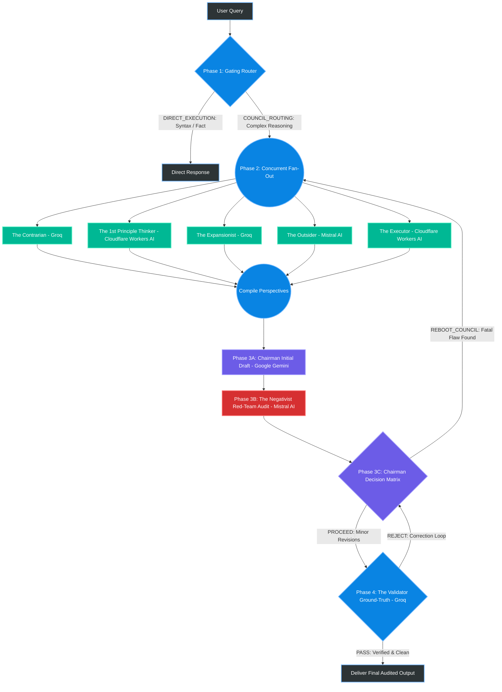

# 🪐 MARS: Multi-Agent Reasoning System

[](https://www.python.org/downloads/)
[](https://opensource.org/licenses/MIT)
[]()
[-brightgreen.svg)]()

MARS (**Multi-Agent Reasoning System**) is a 9-node, multi-provider **Mixture-of-Agents (MoA) / LLM Council** system engineered to systematically force Large Language Models to catch their own hallucinations, biases, and logical blind spots.

---

## 🏛️ System Architecture

Standard single-model inference frequently falls victim to "echo chamber" reasoning and confident hallucinations. MARS executes a 4-phase dialectic pipeline across **heterogeneous zero-cost AI providers** to simulate a rigorous, highly adversarial boardroom deliberation:



---

## 🧩 The 9 Nodes & Provider Topology

| Phase | Node | Role | Provider | Default Model | Temp | Purpose |
| :--- | :--- | :--- | :--- | :--- | :--- | :--- |
| **Phase 1** | 1 | **Gating Router** | Cloudflare Workers AI | `@cf/meta/llama-3.1-8b-instruct-fp8` | 0.0 | Edge triage: `[DIRECT_EXECUTION]` vs `[COUNCIL_ROUTING]` |
| **Phase 2** | 2 | **The Contrarian** | Groq | `qwen/qwen3.8-27b` | 0.6 | Skeptic/Pessimist: Identifies fatal flaws and structural risks |
| **Phase 2** | 3 | **1st Principle Thinker** | Cloudflare Workers AI | `@cf/meta/llama-3.3-70b-instruct-fp8-fast` | 0.5 | Realist: Deconstructs to core physics, math, and irreducible truths |
| **Phase 2** | 4 | **The Expansionist** | Groq | `openai/gpt-oss-120b` | 0.8 | Optimist: Spots asymmetric upsides and second-order scaling angles |
| **Phase 2** | 5 | **The Outsider** | Mistral AI | `mistral-small-latest` | 0.7 | Cynic: Demands empirical proof and tests human incentives |
| **Phase 2** | 6 | **The Executor** | Cloudflare Workers AI | `@cf/deepseek-ai/deepseek-r1-distill-qwen-32b` | 0.5 | Practical Realist: Translates to actionable steps & timelines |
| **Phase 3** | 7 | **The Chairman** | Google AI Studio | `gemini-2.5-flash` | 0.5 | Idealist Synthesizer: Merges council views into comprehensive strategy |
| **Phase 3** | 8 | **The Negativist** | Mistral AI | `mistral-small-latest` | 0.7 | Adversarial Red-Teamer: Decoupled to eliminate self-bias & 429 contention |
| **Phase 4** | 9 | **The Validator** | Groq | `openai/gpt-oss-120b` | 0.0 | Ground-truth auditor: Zero-temperature compiler, syntax, and logic check |

---

## 🚀 Quickstart Guide

### 1. Activate Environment
```bash
conda deactivate
conda activate AIML
```

### 2. Install Dependencies
```bash
pip install -r requirements.txt
```

### 3. Setup API Keys
Copy `.env.example` to `.env` and fill in your developer keys:
```bash
cp .env.example .env
```

Verify your credentials anytime:
```bash
python main.py --check-env
```

### 4. Run System Verification
Run automated tests and diagnostic sanity checks:
```bash
python verify_all.py
```
*(For complete operational documentation, see [GUIDE_RUN_AND_VERIFY.md](file:///d:/Programming/Projects/Multi-Agent%20Reasoning%20System/GUIDE_RUN_AND_VERIFY.md))*

### 5. Launch the Web Interface
```bash
python main.py
```
Open your browser at `http://127.0.0.1:7860`. Includes:
- **Viva Side-by-Side Mode:** Direct comparison between single-model baseline and the 9-node MARS council.
- **Council Deliberation Tabs:** Independent persona analysis review with collapsible `<think>` reasoning traces.
- **Executive Audit Log:** Full audit trail from Initial Draft to Red-Team Critique to Validator Verification.

### 6. CLI Debugging Mode
Run prompts directly from the command line:
```bash
python cli.py "Explain the trade-offs of microservices vs monolith for an early-stage startup."
```

---

## 📊 Automated Benchmarking Suite (LLM-as-a-Judge)

Execute comparative evaluations between single baseline models and the full MARS council with automated blind judge evaluation across Factuality, Blind-Spot Detection, and Actionability:
```bash
python benchmarks/run_benchmark.py
```
Evaluation metrics and rationales are exported to `benchmarks/benchmark_results.json`.

---

## 🛡️ Resilience & Circuit Breakers

- **Automatic Multi-Hop Failovers:** Each node is backed by an ordered list of cross-provider fallback models.
- **Targeted Circuit Breakers:** Circuit breakers trip exclusively on transient infrastructure issues (429 rate limits, 5xx server errors, timeouts) without poisoning healthy model endpoints on 400/404 errors.
- **Unstripped Reasoning Tag Protection:** Internal `<think>...</think>` traces from reasoning models (DeepSeek-R1 / Qwen3) are cleanly isolated to prevent context pollution and token budget exhaustion.
- **Dynamic Council Reboot:** Chairman can issue `[REBOOT_COUNCIL]` when critical foundational flaws are uncovered, re-running the council with feedback.
