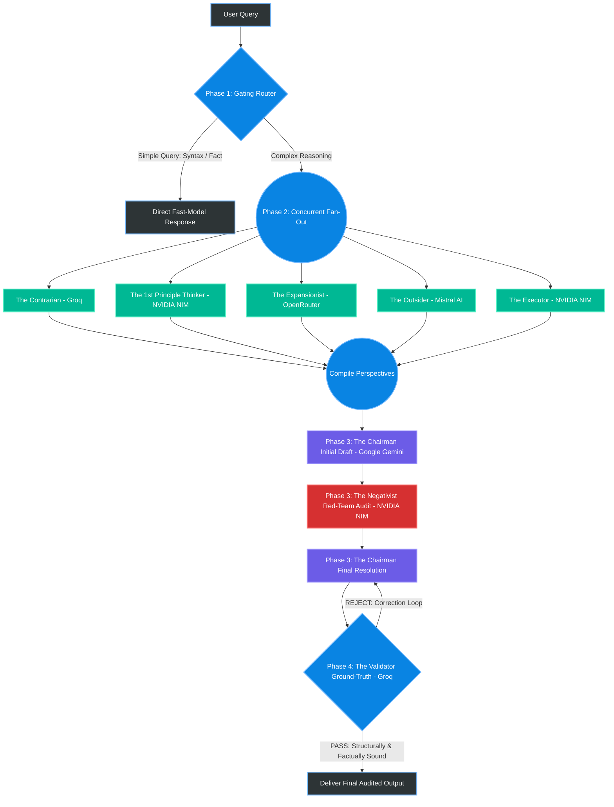

# 🪐 MARS: Multi-Agent Reasoning System

[](https://www.python.org/downloads/)
[](https://opensource.org/licenses/MIT)
[]()
[-brightgreen.svg)]()

MARS (**Multi-Agent Reasoning System**) is a 9-node, multi-provider **Mixture-of-Agents (MoA) / LLM Council** system engineered to systematically force Large Language Models to catch their own hallucinations, biases, and logical blind spots.

---

## 🏛️ System Architecture

Standard single-model inference frequently falls victim to "echo chamber" reasoning and confident hallucinations. MARS executes a 4-phase dialectic pipeline across **6 free-tier AI providers** to simulate a rigorous, highly adversarial boardroom deliberation:



---

## 🧩 The 9 Nodes & Provider Topology

| Phase | Node | Role | Provider | Default Model | Temp | Purpose |
| :--- | :--- | :--- | :--- | :--- | :--- | :--- |
| **Phase 1** | 1 | **Gating Router** | Cloudflare Workers AI | `@cf/meta/llama-3.1-8b-instruct` | 0.0 | Edge triage: `[DIRECT]` vs `[COUNCIL]` |
| **Phase 2** | 2 | **The Contrarian** | Groq | `llama-3.1-8b-instant` | 0.8 | Skeptic/Pessimist: Identifies fatal flaws |
| **Phase 2** | 3 | **1st Principle Thinker** | NVIDIA NIM | `meta/llama-3.1-8b-instruct` | 0.7 | Realist: Deconstructs to core physics & math |
| **Phase 2** | 4 | **The Expansionist** | OpenRouter | `meta-llama/llama-3.3-70b-instruct:free` | 0.85 | Optimist: Spots 100x leverage & scaling angles |
| **Phase 2** | 5 | **The Outsider** | Mistral AI | `mistral-small-latest` | 0.7 | Cynic: Demands proof and questions motives |
| **Phase 2** | 6 | **The Executor** | NVIDIA NIM | `deepseek-ai/deepseek-r1` | 0.6 | Practical: Formulates step-by-step blueprint |
| **Phase 3** | 7 | **The Chairman** | Google AI Studio | `gemini-2.5-flash` | 0.7 | Idealist: Synthesizes & resolves conflicts |
| **Phase 3** | 8 | **The Negativist** | NVIDIA NIM | `deepseek-ai/deepseek-v3` | 0.8 | Red-Team: Ruthlessly attacks Chairman's draft |
| **Phase 4** | 9 | **The Validator** | Groq | `llama-3.3-70b-versatile` | 0.0 | Ground-truth auditor: Syntax, URLs, logic |

---

## 🚀 Quickstart Guide

### 1. Clone and Activate Environment
```bash
conda deactivate
conda activate AIML
```

### 2. Install Dependencies
```bash
pip install -r requirements.txt
```

### 3. Setup API Keys
Copy `.env.example` to `.env` and fill in your developer keys:
```bash
cp .env.example .env
```

Verify your credentials anytime:
```bash
python main.py --check-env
```

### 4. Launch the Web Interface
```bash
python main.py
```
Open your browser at `http://127.0.0.1:7860`.

### 5. CLI Debugging Mode
Run complex prompts directly from the command line:
```bash
python cli.py "How should a startup launch an autonomous drone delivery fleet in suburban markets?"
```

---

## 📊 Benchmarking Suite

Execute comparative evaluations between single frontier model baselines and the full MARS council:
```bash
python benchmarks/run_benchmark.py --limit 3
```
Results and hallucination interception logs are saved to `benchmarks/benchmark_results.csv` and `benchmarks/benchmark_report.md`.

---

## 🛡️ Resilience & Circuit Breakers

- **Automatic Failover Chains:** Each node features secondary fallback providers (e.g., Groq ↔ NVIDIA NIM ↔ OpenRouter).
- **Circuit Breakers:** Repeated rate-limit or outage errors trip automated cooldowns to prevent cascading stalls.
- **Graceful Degradation:** If individual free-tier providers encounter brief timeouts, the executive synthesis proceeds with quorum warning logs.
